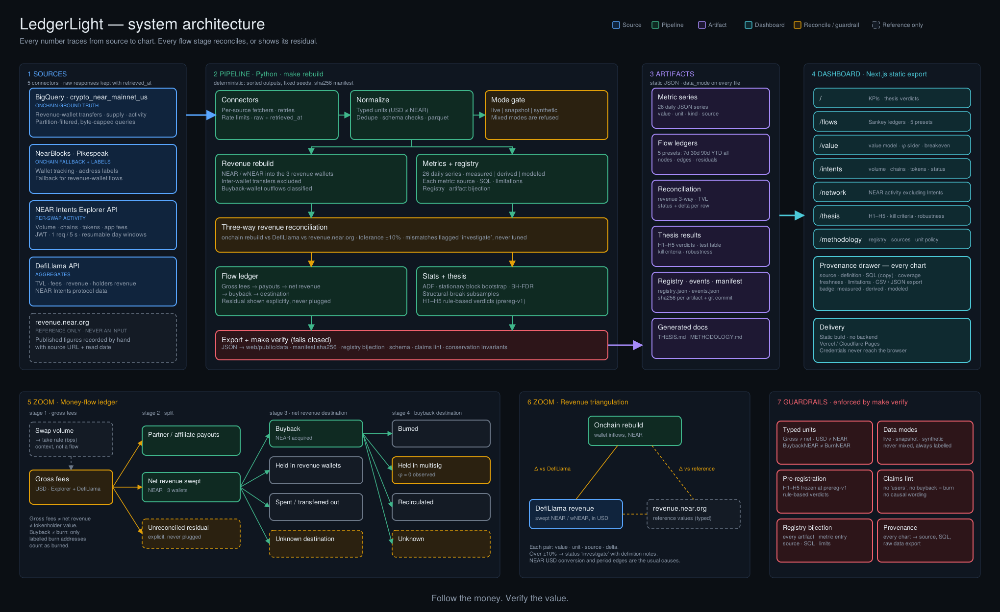

# LedgerLight — NEAR Value Intelligence

**Does NEAR's growing economic activity turn into sustainable economic value for NEAR tokenholders?**

*Follow the money. Verify the value.*

NEAR Hackathon, November 2026 · Track: Thesis · Solo: [Nikhil Kottoli](https://github.com/NikhilKottoli)
[Repo](https://github.com/NikhilKottoli/LedgerLight) · [Live demo](https://through-ellen-richmond-directive.trycloudflare.com/)

---

## Headline finding

revenue.near.org says buybacks "permanently remove NEAR from circulation." DefiLlama says the bought-back NEAR is not burned. LedgerLight checks this onchain: the bought-back NEAR sits in `buybacks.multisignature.near` and has not gone to a burn destination (φ = 0 observed).

Under that observation, the burn breakeven in the value model is unreachable. The buyback breakeven (buybacks offsetting net issuance) needs about 13.5× current Intents volume at current parameters. That figure is **modeled**, not measured.

Deployed site: https://ledgerlight-jl1f.onrender.com/

## What it does

It traces gross fees through to tokenholder-relevant outcomes and shows, at every stage, whether the numbers reconcile.

- **Onchain revenue rebuild.** Net revenue is reconstructed from NEAR/wNEAR transfers into the three revenue wallets (inter-wallet transfers excluded), then compared with DefiLlama and revenue.near.org.
- **Buyback vs burn.** Outflows from the buyback wallet are classified (burn, treasury, staking, exchange, unknown).
- **Honest flows.** Each Sankey stage reconciles or shows an explicit unreconciled amount. Nothing is forced to balance.
- **Pre-registered tests.** H1–H5 and their kill criteria were frozen at tag `prereg-v1` before any analysis ran. Verdicts come from rules: `SUPPORTED | CONTRADICTED | MIXED | INSUFFICIENT_DATA`.
- **Current conclusion.** The current evidence is mixed: H1 is partial/mixed, H2 is contradicted, H3 is supported, H4 is mixed, and H5 remains unobserved until sender-census data is available.
- **Typed units.** `GrossFeesUSD`, `NetRevenueNEAR`, `BuybackNEAR` and `BurnNEAR` are separate types. Mixing them fails.
- **Provenance on every chart.** Click a chart to see its source, definition, SQL, registry entry and raw data.

## Dashboard

| Route | Content |
|---|---|
| `/` | KPIs and thesis verdicts |
| `/flows` | Sankey ledgers for 7d / 30d / 90d / YTD / all-time |
| `/value` | Value capture model with a burn-fraction (φ) slider and breakeven |
| `/intents` | Volume, status mix, chain and token distribution |
| `/network` | NEAR activity excluding Intents |
| `/thesis` | H1–H5 results, kill criteria, robustness |
| `/methodology` | Metric registry, sources, unit policy, statistical method |

## Architecture

```
Sources            Pipeline (Python)       Artifacts          Dashboard
DefiLlama     ┐    connectors             26 daily series    Next.js
Intents API   │    normalize              5 flow ledgers     static export
BigQuery      ├─▶  metrics + flows   ─▶   registry, events ─▶ 7 routes
NearBlocks    │    stats (bootstrap)      reconciliation     provenance drawer
Pikespeak     ┘    thesis + verify        manifest (sha256)
```

The pipeline writes static JSON and the dashboard only reads it, so credentials never reach the browser.



*Editable source: `architecture.excalidraw` — open in [excalidraw.com](https://excalidraw.com/)*

## Quick start (snapshot mode, no credentials)

```bash
git clone https://github.com/NikhilKottoli/LedgerLight.git
cd LedgerLight

uv venv --python 3.11 && uv sync --frozen      # or: pip install -e .
cd web && pnpm install --frozen-lockfile && pnpm build
pnpm preview                                   # http://localhost:4173
```

Snapshot mode serves the committed `data/snapshot/`: real, aggregated data from an earlier live run, shown with an amber banner and its date.

## Live mode

```bash
cp .env.example .env     # then fill in the values below
make rebuild MODE=live
```

| Variable | Purpose | Notes |
|---|---|---|
| `NEAR_INTENTS_JWT` | Per-transaction Intents data | Request at partners.near-intents.org. Limit: 1 request / 5 s. Never commit it. |
| `GOOGLE_APPLICATION_CREDENTIALS` | BigQuery service-account key | Roles: `bigquery.jobUser`, `bigquery.dataViewer` |
| `BQ_PROJECT` | GCP project id | Free tier is 1 TB/month. Set a billing cap. |

Cost cap example: `bq update --project_id=YOUR_PROJECT --default_query_job_properties='{"maximumBytesBilled": "1000000000000"}'`

Stage by stage: `make fetch | normalize | metrics | flows | stats | thesis | export | report MODE=live`

## Verify

```bash
make verify MODE=snapshot    # registry ↔ artifacts, schemas, claims lint, manifest hashes
make test                    # Python + JS unit tests
cd web && PLAYWRIGHT_BASE_URL=http://localhost:3011 npx playwright test
```

Checks: registry ↔ artifact bijection (26 ↔ 26), schema and freshness validation, claims lint (no "users", no "buyback = burn"), sha256 manifest, and Playwright across all 7 routes with 0 console errors.

## Data modes

| Mode | Meaning | Banner |
|---|---|---|
| `live` | Pipeline just ran against real APIs | Green, with retrieval timestamp |
| `snapshot` | Committed real data from an earlier live run (default) | Amber, with snapshot date |
| `synthetic` | Test fixtures only | Red, watermark on every chart |

The pipeline refuses to combine artifacts from different modes.

## Research status

Hypotheses and thresholds are frozen at `prereg-v1`.

```bash
git show prereg-v1:thesis/PREREGISTRATION.md
make thesis MODE=snapshot && cat thesis/thesis_results.json
```

| ID | Claim | Verdict | Blocked by |
|---|---|---|---|
| H1 | Intents adoption is growing sustainably | `PARTIAL / MIXED` | Sender and concentration tests require Intents JWT |
| H2 | Intents predicts non-Intents NEAR activity | `CONTRADICTED` | No qualifying lag at n = 52 |
| H3 | NEAR captures meaningful value from Intents | `SUPPORTED` | Three-way reconciliation remains partial |
| H4 | Protocol growth benefits tokenholders | `MIXED` | Buyback is not burn (`φ = 0` observed) |
| H5 | Adoption is becoming less concentrated | `INSUFFICIENT_DATA` | Explorer JWT sender census |

H5 stays in the scorecard and is explicitly marked `INSUFFICIENT_DATA`; it is
not assigned a directional conclusion without sender-census evidence.

## Repo layout

```
pipeline/    connectors · normalize · metrics · flows · stats · thesis · export · verify
web/         Next.js app (src/app: 7 routes) · public/data: metric and flow JSON
sql/         cost-controlled BigQuery SQL (dry-run bytes/date recorded before use)
thesis/      PREREGISTRATION.md · hypotheses.yaml · thesis_results.json
metrics/     registry.yaml
data/        raw/ and processed/ (gitignored) · snapshot/ (committed) · reference/ (manual, sourced)
plans/       9 gated build plans · AGENTS.md · DECISIONS.md · BLOCKERS.md
```

Also: `THESIS.md`, `METHODOLOGY.md`.

## Limitations

- **Accounts are not humans.** Active accounts are distinct signer accounts with ≥1 transaction a day. Multisigs, exchanges and bots inflate the count.
- **Addresses are not people.** Intents metrics say "unique sender addresses." One person on several chains is several addresses.
- **Confidential flows.** `CONFIDENTIAL_INTENTS` deposits and recipients are only partly visible.
- **Explorer coverage.** The Explorer API covers 1Click transactions only. Other integrations may differ.
- **Price conversion.** NEAR↔USD conversion adds noise, so NEAR-denominated revenue is primary.
- **Timing.** Fees accrue per swap, but sweeps to protocol wallets happen later, with variable lag.
- **BigQuery quota.** Revenue-wallet outflow analysis is limited by the free tier.

## License and sources

MIT.

Data from DefiLlama, the NEAR Intents Explorer API, BigQuery public datasets (`crypto_near_mainnet_us`), NearBlocks, Pikespeak, and revenue.near.org as a reference cross-check.
